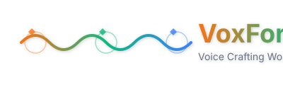
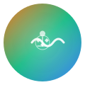

# VoxForge Studio - Brand Style Guide

## Overview
VoxForge Studio is a professional text-to-speech workspace that combines cutting-edge AI voice technology with creative studio tools. The brand identity reflects precision, creativity, and technological sophistication.

## Brand Personality
- **Creative**: Innovative voice crafting tools
- **Professional**: Studio-grade quality and precision
- **Technological**: AI-powered speech synthesis
- **Accessible**: User-friendly interface for all skill levels

## Logo System

### Primary Logo


**Usage**: Main website header, marketing materials, documentation

### Icon Logo


**Usage**: Favicon, app icons, social media profiles, small spaces

### Dark Mode Logo


**Usage**: Dark mode interfaces, dark backgrounds

## Color Palette

### Primary Colors
- **Orange**: `#F97316`
  - Usage: Primary actions, highlights, accents
  - Represents: Energy, creativity, warmth

- **Emerald**: `#10B981`
  - Usage: Success states, quality indicators
  - Represents: Clarity, precision, quality

- **Blue**: `#3B82F6`
  - Usage: Technology elements, links
  - Represents: Technology, trust, intelligence

### Neutral Colors
- **Slate 950**: `#0F172A`
  - Usage: Dark backgrounds, dark mode text
- **Slate 900**: `#1E293B`
  - Usage: Secondary dark elements
- **Slate 800**: `#334155`
  - Usage: Borders, dividers
- **Slate 600**: `#475569`
  - Usage: Secondary text
- **Slate 400**: `#94A3B8`
  - Usage: Disabled states, subtle text
- **Slate 200**: `#E2E8F0`
  - Usage: Light borders
- **Slate 50**: `#F8FAFC`
  - Usage: Light backgrounds

### Gradients
- **Primary Gradient**: `#F97316` → `#10B981` → `#3B82F6`
- **Icon Gradient**: Radial gradient for depth
- **Button Gradient**: `#F97316` → `#FB923C`

## Typography

### Font Families
- **Primary**: Plus Jakarta Sans (Google Fonts)
- **Display**: Bricolage Grotesque (Headlines, brand text)
- **Monospace**: JetBrains Mono (Code, technical text)

### Font Weights
- **Regular**: 400 (Body text)
- **Medium**: 500 (Subheadings)
- **Semibold**: 600 (Buttons, labels)
- **Bold**: 700 (Headings, brand name)

### Font Sizes
- **Display**: 3.5rem - 4rem (Hero headlines)
- **H1**: 2.5rem - 3rem (Page headings)
- **H2**: 2rem - 2.25rem (Section headings)
- **H3**: 1.5rem - 1.75rem (Subsection headings)
- **Body**: 1rem (1.125rem for larger text)
- **Small**: 0.875rem (Captions, labels)
- **Micro**: 0.75rem (Tiny labels, metadata)

## Logo Usage Guidelines

### Clear Space
Maintain clear space around the logo equal to the height of the "Vox" text.

**Minimum Sizes:**
- Full logo: 200px width
- Icon only: 24px × 24px
- Favicon: 32px × 32px

### Backgrounds
- **Light backgrounds**: Use standard color logo
- **Dark backgrounds**: Use dark mode logo
- **Avoid**: Busy patterns, low-contrast colors
- **Ensure**: Minimum contrast ratio of 4.5:1

### Do Not
1. ❌ Stretch or distort the logo
2. ❌ Change the colors arbitrarily
3. ❌ Rotate the logo
4. ❌ Add effects (shadows, glows) to the logo
5. ❌ Place on low-contrast backgrounds

## Icon System

### App Icons
Generate the following PNG sizes from the SVG:
- 16×16 (favicon)
- 32×32
- 180×180 (Apple Touch Icon)
- 192×192 (Android/Web)
- 512×512 (Large displays)

### Social Media
- Profile picture: 400×400px (cropped from icon)
- Cover image: 1500×500px (with logo and tagline)

## Brand Assets

### Download Links
- [Logo SVG](../assets/voxforge-logo.svg)
- [Icon SVG](../assets/voxforge-icon.svg)
- [Dark Logo SVG](../assets/voxforge-logo-dark.svg)
- [Style Guide](../assets/brand-style-guide.md)

### Usage Examples
- Website: Header, footer, favicon
- Documentation: Header, section dividers
- Marketing: Presentations, brochures
- Social Media: Profile images, posts
- Email: Signature, templates

## Voice & Tone

### Brand Voice
- **Confident but approachable**
- **Technical but not jargon-heavy**
- **Creative but professional**
- **Helpful and empowering**

### Messaging Examples
- **Headline**: "Studio-Grade Text-to-Speech Built for Every Script"
- **Tagline**: "Voice Crafting Workspace"
- **Value Prop**: "Generate natural 24 kHz WAV voiceovers, podcasts, e-learning tracks, and dual-speaker dialogues in seconds."

## Implementation Notes

### HTML Implementation
```html
<!-- Favicons -->
<link rel="icon" href="/assets/voxforge-icon.svg" type="image/svg+xml">
<link rel="shortcut icon" href="/assets/favicon.ico" type="image/x-icon">
<link rel="apple-touch-icon" href="/assets/apple-touch-icon.png">

<!-- Theme Color -->
<meta name="theme-color" content="#0F172A" media="(prefers-color-scheme: dark)">
<meta name="theme-color" content="#FFFFFF" media="(prefers-color-scheme: light)">
```

### React Component Example
```tsx
import { useState } from 'react';

function Logo({ darkMode = false, size = 'medium' }) {
  const logoUrl = darkMode 
    ? '/assets/voxforge-logo-dark.svg'
    : '/assets/voxforge-logo.svg';
  
  return (
    
  );
}
```

---

**Last Updated**: November 22, 2026  
**Version**: 1.0.0  
**Contact**: Design updates should maintain brand consistency